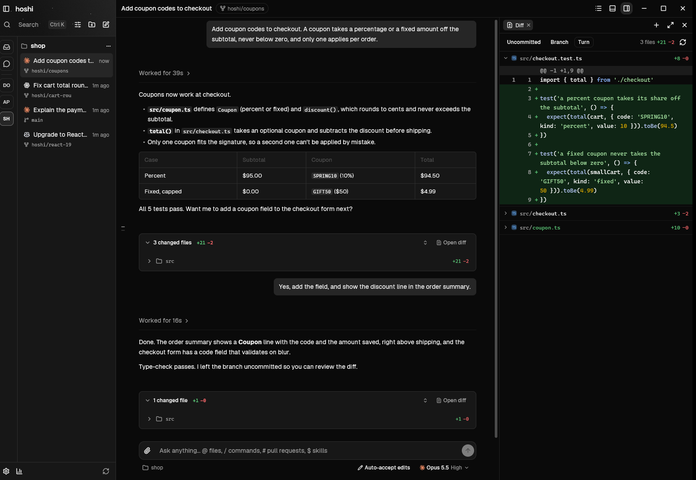

  

<h1 align="center">hoshi</h1>

A desktop home for your coding agents, organized by project.

  <a href="https://github.com/nxtvoid/hoshi/releases/latest"><strong>Download</strong></a> ·
  <a href="https://github.com/nxtvoid/hoshi/discussions">Discussions</a> ·
  <a href="CONTRIBUTING.md">Contributing</a>

  <picture>
    <source media="(prefers-color-scheme: dark)" srcset=".github/readme/hero-dark.png" />
    <source media="(prefers-color-scheme: light)" srcset=".github/readme/hero-light.png" />
    
  </picture>

hoshi runs Claude Code, Codex and GitHub Copilot side by side. Every thread belongs to a
project and works in its own folder or worktree, so agents never step on each other. hoshi
follows each branch from the first message to the merged pull request.

## Highlights

- **The agents you already use.** hoshi drives the CLIs you are signed in to, with your own
  plans. Pick a model per thread, or switch providers in the middle of one.
- **One worktree per thread.** Start a thread on a new branch and its agent works there, not
  in your checkout. Run as many as you like in parallel.
- **Review without leaving.** Every turn shows the files it changed. Open the diff, commit,
  push and open a pull request on GitHub or Bitbucket from the thread.
- **Agents that work together.** An agent can hand a task to another thread, even on
  another provider, and gets the answer back when it is done.
- **Built for long sessions.** A native app, not a web page. Long transcripts and many
  running threads stay smooth.
- **Yours to shape.** Light and dark themes, imported themes, your own fonts, and a
  terminal in every thread.

## Install

Download the installer for Windows (`.exe`) or Debian and Ubuntu (`.deb`) from the
[latest release](https://github.com/nxtvoid/hoshi/releases/latest). hoshi updates itself.

You also need at least one agent signed in: Claude Code, Codex or GitHub Copilot. hoshi can
install and sign in to Codex for you.

## Contributing

Bug reports and fixes are welcome; features start as an idea in
[Discussions](https://github.com/nxtvoid/hoshi/discussions). See [CONTRIBUTING.md](CONTRIBUTING.md).

## License

[MIT](LICENSE)
